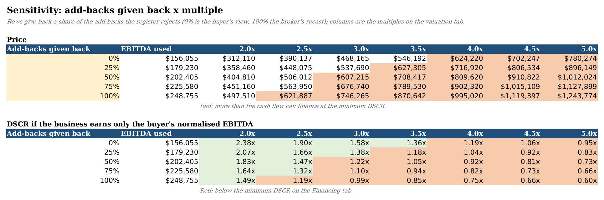

# sde-value

sde-value takes a small-business deal file (the seller's P&L plus the broker's list of add-backs) and builds an Excel workbook. Each add-back gets its own row with a 1/0 toggle, and the owner's job is priced at what it would cost to hire a manager. I built it because a broker's recast usually adds back the owner's whole salary and anything that can be called "one-time", applies a multiple, and never puts back the cost of someone to run the business. A $31,000 "one-time" warranty problem that shows up every year costs a buyer $124,000 at a multiple of four.

The value updates as you flip toggles. Three more tabs ask whether the price makes sense from other directions: a five-year DCF, an acquisition loan with debt service coverage, and a grid of price and coverage across multiples and how many of the rejected add-backs you give back. A separate Python engine recomputes every output, so you can check the spreadsheet rather than just trust it.

## Running it

You need Python 3.10+, plus LibreOffice for the `check` step and the recalculation tests.

```bash
sudo apt-get install -y libreoffice-calc
pip install -e ".[test]"

python3 -m sde_value build --deal deals/hvac_service.yaml --out out/hvac_service.xlsx
python3 -m sde_value check out/hvac_service.xlsx
python3 -m sde_value check out/hvac_service.xlsx --tabs DCF,Financing,Sensitivity
python3 -m sde_value summary deals/*.yaml
python3 -m pytest
```

For the HVAC sample, the first three print:

```
Wrote out/hvac_service.xlsx
  Lone Star Comfort Air (sample)
  Seller's SDE            $386,800   (add-backs claimed $291,800)
  Normalised SDE          $294,100   (rejected $92,700)
  Owner replacement       $138,045
  Normalised EBITDA       $156,055
  Asking value          $1,547,200   at 4.0x
  Repriced value          $624,220   (59.7% below asking)
  DCF value               $486,172   (3.1x normalised EBITDA)
  Largest financeable     $593,621   (DSCR at asking 0.48x, needs 1.25x)

OK: 264 output cells compared after LibreOffice recalculation, 0 mismatches, 0 missing
OK: 159 output cells on DCF, Financing, Sensitivity compared after LibreOffice recalculation, 0 mismatches, 0 missing
```




The other tabs are in `docs/` too: [DCF](docs/dcf.png), [Financing](docs/financing.png), [Normalised Earnings](docs/normalised-earnings.png) and [Multiple Valuation](docs/multiple-valuation.png).

Everything runs offline from the extracts in `data/`. `fetch-data` downloads the BLS and IRS files again, which was more annoying than it should have been. The BLS CDN returned 403 to Python's urllib even with browser headers, so the fetcher shells out to curl when it can.

The deal file format is in [docs/deal-file.md](docs/deal-file.md), commands and options in [docs/commands.md](docs/commands.md), and data sources in [data/SOURCES.md](data/SOURCES.md).

## How it works

Each add-back records which P&L line it comes out of, what the seller calls it, how many of the last three years it appeared in, whether the cost would continue under a new owner, and whether there are documents for it. The classification rule had to be short enough to fit in one Excel formula. Owner pay, depreciation and interest keep their labels. A "one-time" item seen in two or more years, or anything that carries on after the sale, becomes recurring-disguised and is rejected. Undocumented discretionary or one-time items are rejected too. You can override any row in the deal file, or just flip the toggle in Excel.

The manager's cost comes from BLS OES wages. OES doesn't publish wages by industry and state together, so I take the national wage for the role in the 4-digit NAICS industry and scale it by the state's cross-industry wage relative to the national one. Benefits go on top from BLS ECEC data for small private employers. Normalised SDE is net income plus accepted add-backs, normalised EBITDA subtracts the manager, and both sit next to IRS SOI ratios for the same industry as a sanity check.

The DCF tab grows revenue at 3% a year for five years, holds the normalised EBITDA margin flat, takes off maintenance capex (the seller's own depreciation rate unless the deal file says otherwise), working capital for the new revenue and a 25% tax, then discounts at 20% with a Gordon terminal value. 20% sounds high, but it's in the range people quote for small private companies, and every assumption is a yellow cell. I treat the result as a second opinion: if the DCF and the repriced multiple are far apart, one of them is wrong about growth or risk.

The Financing tab prices the deal the way most first-time buyers pay for it: an SBA 7(a)-style loan with 10% down, ten years at 10.5% with monthly payments, and an optional seller note. It works out debt service at the asking price, the repriced value and the DCF value, divides the buyer's cash flow (normalised EBITDA less maintenance capex) by it, and checks the result against a 1.25x minimum. It also turns the problem around and solves for the largest price that cash flow can carry. The cash flow stays the buyer's view whatever the price, because paying more doesn't make the business earn more.

The Sensitivity tab is a 5 x 7 grid. Rows give back 0%, 25%, 50%, 75% or 100% of the add-backs the register rejected (0% is the buyer's view, 100% is the broker's recast), columns are the multiples from the valuation tab, and each cell is a formula off its row and column headers. A second grid underneath shows DSCR for each of those prices, and anything a lender would turn down is shaded red.

The workbook writes inputs as values and everything else as formulas, each with a defined name, and the engine computes the same names in Python. `check` recalculates the file in headless LibreOffice, reads the inputs back out, runs the engine on them and compares every output. It reads the workbook, not the deal file, so it still works after you've flipped toggles. `--tabs` limits the comparison to cells on the tabs you name. Tests break formulas on purpose (including a DCF tax line and a pasted number in the sensitivity grid) to make sure the checker notices.

The three deals in `deals/` are made up, but each P&L line is revenue times the IRS SOI ratio for that industry (a test checks this).

| Deal | Seller's SDE | Normalised EBITDA | Asking | Repriced | Cut |
|---|---:|---:|---:|---:|---:|
| HVAC service, TX, 4.0x | $386,800 | $156,055 | $1,547,200 | $624,220 | 59.7% |
| Landscaping, NC, 3.5x | $240,800 | $73,612 | $842,800 | $257,640 | 69.4% |
| Laundromat, OH, 4.5x | $157,500 | $77,705 | $708,750 | $349,673 | 50.7% |

The laundromat only needs a half-time manager, which is why it loses the least.

None of the three asking prices can be borrowed. At the default loan terms the asking price covers its debt service 0.38 to 0.56 times, and even the repriced value misses 1.25x by a little:

| Deal | DCF value | DCF / normalised EBITDA | DSCR at asking | Largest financeable price | As a multiple of seller's SDE |
|---|---:|---:|---:|---:|---:|
| HVAC service | $486,172 | 3.1x | 0.48x | $593,621 | 1.5x (asks 4.0x) |
| Landscaping | $197,393 | 2.7x | 0.38x | $254,479 | 1.1x (asks 3.5x) |
| Laundromat | $254,453 | 3.3x | 0.56x | $319,062 | 2.0x (asks 4.5x) |

On the HVAC grid, 12 of the 35 cells clear 1.25x and none of them is at the broker's 4.0x.

## Known issues

- The repriced value applies the broker's SDE multiple to normalised EBITDA. Real EBITDA multiples for small companies are often different, so read the cut as how much of the price rests on the recast, not as a fair price.
- SOI ratios cover all corporations in a minor industry, which skews bigger than a typical listing. Some SOI cells are withheld and count as zero, and landscaping has to use a broader category than its NAICS code.
- Only expense add-backs are modelled. Unreported cash, working capital and capex normalisation aren't in yet.
- The DCF holds the margin flat and uses one tax rate on EBITDA less capex as a stand-in for the owner's tax. It's there to sanity-check the multiple, not to model a particular buyer.
- Coverage uses one year of trailing cash flow. Lenders also look at the buyer's own living costs, personal guarantees and collateral, none of which are here, and SBA rates move with prime, so the 10.5% default needs updating by hand.
- The DCF has a fixed number of year columns once the workbook is built. Changing `dcf.years` means rebuilding.
- Next I'd like to compare deals side by side in one workbook, and model working capital and capex normalisation in the recast itself.

Project period: 2026-07-13 to 2026-07-17.
