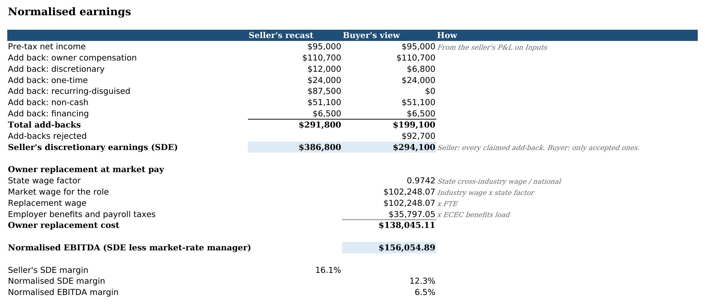
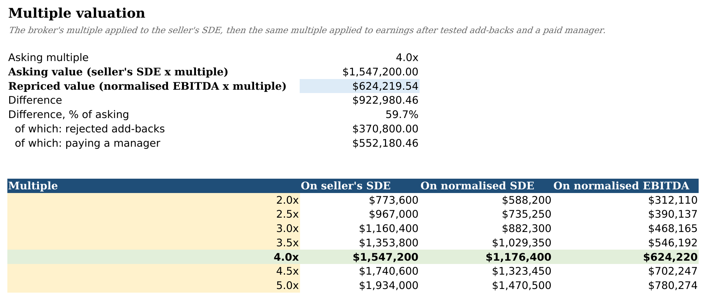

# sde-value

**An Excel valuation workbook that tests a seller's add-backs and pays a market-rate manager before the multiple goes on.**

Point it at a deal file (the seller's P&L plus the broker's list of add-backs) and it writes an `.xlsx`
where every add-back has its own row, a classification and a 1/0 toggle, the owner's job is priced at the
BLS wage for that role in that industry and state, and the value is recalculated live as you flip toggles.
A second, independent Python engine recomputes every output cell, and a checker runs the workbook through
headless LibreOffice to confirm the two agree to the cent.

It's for people doing a first pass on a small-business purchase: first-time and search-fund buyers, owners
who want to see how a buyer will pick apart their recast before they list, and interns building their first
SDE analysis.


## Why

A broker's recast usually starts with pre-tax profit, adds back the owner's entire salary and perks plus
anything that can be called "one-time" or "discretionary", and multiplies the result by 3-5x. Two things
get lost on the way:

1. Someone still has to run the business. If you take the owner's pay out of costs, you have to put back
   what it costs to hire a manager, including payroll taxes and benefits.
2. Every dollar of add-back is multiplied. A $31,000 "one-time" warranty problem that actually happens
   every year costs a buyer $124,000 at 4x.

The thread [Calculating seller's participation into valuation](https://searchfunder.com/post/calculating-sellers-participation-into-valuation)
on Searchfunder is a good example of buyers trying to work out how much to deduct for replacing the owner.
I wanted a workbook where that deduction comes from real wage data rather than a guess, and where each
add-back is a visible decision instead of a line buried in a recast.

## What it does

- **Add-back register**: each item is classified as owner compensation, non-cash, financing,
  discretionary, one-time or **recurring-disguised**, with its supporting documents and an Accept? toggle.
  The classification is itself a live formula, so changing "years seen" or "continues after sale?" can
  flip it.
- **Owner replacement cost** from BLS OES (May 2024) wages for the replacement role in the business's
  4-digit NAICS industry, scaled to the state, plus a benefits load from BLS ECEC.
- **Two normalisations**: normalised SDE (net income plus accepted add-backs) and normalised EBITDA (SDE
  minus the market-rate manager), each valued across a range of multiples.
- **Industry baseline** from IRS SOI Table 5.1 (tax year 2022), so the seller's cost ratios and the
  normalised margin sit next to what corporations in the same minor industry actually report.
- **Formula/engine agreement**: `check` recalculates the workbook in headless LibreOffice and compares all
  output cells (105 for the HVAC deal) with the Python engine.

## Getting started

Needs Python 3.10+ and LibreOffice (only for `check` and the recalculation tests).

```bash
sudo apt-get install -y libreoffice-calc     # for the recalculation check
pip install -e ".[test]"                     # or: pip install -r requirements.txt

python3 -m sde_value build --deal deals/hvac_service.yaml --out out/hvac_service.xlsx
python3 -m sde_value check out/hvac_service.xlsx
python3 -m sde_value summary deals/*.yaml
python3 -m pytest
```

Output of the first two:

```
Wrote out/hvac_service.xlsx
  Lone Star Comfort Air (sample)
  Seller's SDE            $386,800   (add-backs claimed $291,800)
  Normalised SDE          $294,100   (rejected $92,700)
  Owner replacement       $138,045
  Normalised EBITDA       $156,055
  Asking value          $1,547,200   at 4.0x
  Repriced value          $624,220   (59.7% below asking)

OK: 105 output cells compared after LibreOffice recalculation, 0 mismatches, 0 missing
```

The cached data in `data/` is enough to run everything offline. `python3 -m sde_value fetch-data`
downloads the BLS and IRS files again and rebuilds the extracts (see [data/SOURCES.md](data/SOURCES.md)).
`PYTHONPATH=. python3 scripts/screenshots.py out/hvac_service.xlsx docs/` regenerates the images here.

## Sample deals

The three deals in `deals/` are made up but not arbitrary: every P&L line is the revenue times the IRS SOI
ratio for the matching minor industry, rounded to $100 (a test checks this), and the add-backs are the
kind a broker's recast lists for that sort of business. Each one is commented in the YAML.

| Deal | State | Seller's SDE | Normalised EBITDA | Asking | Repriced at the same multiple | Cut |
|---|---|---:|---:|---:|---:|---:|
| HVAC service, 4.0x | TX | $386,800 | $156,055 | $1,547,200 | $624,220 | 59.7% |
| Landscaping, 3.5x | NC | $240,800 | $73,612 | $842,800 | $257,640 | 69.4% |
| Laundromat, 4.5x (half-time manager) | OH | $157,500 | $77,705 | $708,750 | $349,673 | 50.7% |

Across the three the repriced value is on average 59.9% below asking. For HVAC, $370,800 of the gap comes
from the $92,700 of rejected add-backs and $552,180 from paying a general manager $102,248 plus 35% benefits.

The more interesting check is the baseline tab. The seller's HVAC SDE margin is 16.1%; after the add-backs are
tested and a manager is paid, the normalised EBITDA margin is 6.5%, against 7.2% for plumbing/HVAC
corporations in the SOI data (net income plus interest and D&A, with officers already paid). Landscaping
ends up 6.7 points below its industry benchmark, which mostly says the buyer would be hiring a full GM for
a business the SOI averages treat as more profitable.



## How it works

A deal file (`deals/*.yaml`) holds the seller's P&L, the asking multiple, the replacement role (SOC code,
wage percentile, FTE) and the add-backs. Each add-back says which P&L line it comes out of, what the seller
calls it, how many of the last three years it appeared in, whether the expense would continue under a new
owner, and whether it's documented. Loading the deal rejects add-backs that are larger than the line they
come out of.

The classification rule is short enough to be one Excel formula: owner pay, depreciation/amortisation and
interest keep their labels; a "one-time" item seen in two or more years, or anything that continues after the
sale, becomes recurring-disguised and is rejected; an undocumented discretionary or one-time item is
rejected. The deal can override the recommendation for any row, and so can anyone with the workbook open.

OES doesn't publish wages by industry *and* state, so the replacement wage is the national wage for the
role in the 4-digit NAICS industry, multiplied by the ratio of the state's cross-industry wage for that role
to the national one. The benefits load is total benefits over wages per hour from the latest ECEC quarter
for private establishments with 1-49 workers (35.0%). Both inputs, and where they came from, are on the
Inputs and Sources tabs.

`sde_value/workbook.py` writes inputs as values and everything else as formulas, and gives each cell a
defined name (`i_revenue`, `o_normalised_ebitda`, `o_ab7_class`...). `sde_value/engine.py` computes the same
quantities under the same keys. `sde_value/check.py` converts the workbook with headless LibreOffice
(private profile, so it never touches a running instance), reads the inputs back out of the recalculated
file, runs the engine on them and compares every named output: strings exactly, money to half a cent, ratios
to 1e-9. Because the engine reads the workbook's inputs rather than the deal file, the check still works
after you flip toggles. The tests include flipping a toggle (value moves by exactly amount x multiple) and
breaking a formula on purpose (the checker reports it).



## Layout

```
sde_value/      data loaders, fetcher, deal schema, add-back rules, engine, workbook builder, checker, CLI
deals/          sample deal files
data/           cached BLS OES, BLS ECEC and IRS SOI extracts, with SOURCES.md
tests/          pytest suite
scripts/        screenshot rendering
docs/           README images
```

## Known issues

- The repriced value applies the broker's SDE multiple to normalised EBITDA. That isolates what the add-backs
  and the manager are worth, but real EBITDA multiples for small companies are often different from SDE
  multiples, so treat the cut as "how much of the asking price rests on the recast", not as a fair price.
- SOI ratios are for all active corporations in a minor industry, which skews larger than a typical
  listing. Landscaping uses "Other administrative and support services", which is broader than NAICS 5617.
  Some SOI cells are withheld (`d`) and count as zero.
- Only expense add-backs are modelled. Unreported cash income, working-capital adjustments and capex
  normalisation aren't in yet.
- The state wage adjustment assumes the industry premium is the same in every state.
- `check` needs LibreOffice; the workbook itself opens in Excel or LibreOffice without it.
- This is a screening model, not tax structuring, legal advice or a formal appraisal.

Next up: a DCF cross-check with loan coverage and sensitivity tables, then a buyer memo and a side-by-side
comparison of several deals.
