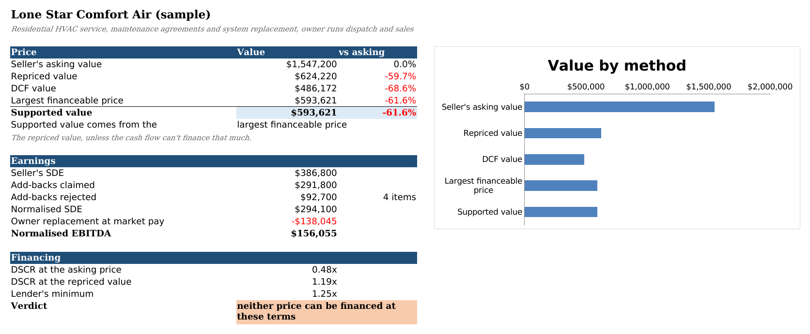

# sde-value

sde-value takes a small-business deal file (the seller's P&L and the broker's list of add-backs) and builds an Excel workbook. Each add-back gets its own row with a 1/0 toggle, and the owner's job is priced at what it would cost to hire a manager. I wrote it because a broker's recast usually adds back the owner's whole salary plus anything that can be called "one-time", applies a multiple, and never puts back the cost of someone to run the place.

## Running it

You need Python 3.10+, and LibreOffice for `check` and the recalculation tests.

```bash
sudo apt-get install -y libreoffice-calc
pip install -e ".[test]"

python3 -m sde_value build --deal deals/hvac_service.yaml --out out/hvac_service.xlsx
python3 -m sde_value check out/hvac_service.xlsx
python3 -m sde_value memo --deal deals/hvac_service.yaml
python3 -m sde_value batch deals/ --out out/
python3 -m pytest
```

For the HVAC sample, `build` and `check` print:

```
Wrote out/hvac_service.xlsx
  Lone Star Comfort Air (sample)
  Seller's SDE            $386,800   (add-backs claimed $291,800)
  Normalised SDE          $294,100   (rejected $92,700)
  Owner replacement       $138,045
  Normalised EBITDA       $156,055
  Asking value          $1,547,200   at 4.0x
  Repriced value          $624,220   (59.7% below asking)
  DCF value               $486,172   (3.1x normalised EBITDA)
  Largest financeable     $593,621   (DSCR at asking 0.48x, needs 1.25x)
  Supported value         $593,621   (capped at the largest financeable price; neither price can be financed at these terms)

OK: 269 output cells compared after LibreOffice recalculation, 0 mismatches, 0 missing
```

The workbook opens on a dashboard ([PDF](docs/dashboard.pdf)):



`memo` writes a two-page Word memo for whoever has to make the call, and `batch` does a whole folder of deals plus a `summary.xlsx` that puts them side by side. Everything runs offline from the extracts in `data/`.

- Worked example, deal file to memo: [docs/worked-example.md](docs/worked-example.md)
- Commands and options: [docs/commands.md](docs/commands.md)
- Deal file format: [docs/deal-file.md](docs/deal-file.md)
- DCF, Financing and Sensitivity tabs: [docs/valuation-tabs.md](docs/valuation-tabs.md)
- Results for all three sample deals: [docs/sample-deals.md](docs/sample-deals.md)
- Data sources: [data/SOURCES.md](data/SOURCES.md)

## How it works

Each add-back records which P&L line it comes from, what the seller calls it, how many of the last three years it showed up in, whether the cost carries on under a new owner, and whether there are documents. The rule had to fit in one Excel formula, so it's short. A "one-time" item seen in two or more years gets rejected, and so does anything that continues after the sale or anything discretionary with no paperwork. In the HVAC sample, $31,000 of "one-time" warranty callbacks appears in all three years. You can override any row in the deal file or just flip the toggle in Excel.

The manager's cost comes from BLS wage data. OES doesn't publish wages by industry and state together, so I take the national wage for the role in that industry, scale it by how the state compares to the country across all industries, and add benefits from ECEC. Normalised EBITDA is net income plus the accepted add-backs minus that manager. The workbook then prices the business three ways (the broker's multiple, a five-year DCF and an SBA-style loan). The supported value on the dashboard is the repriced value capped at what the cash flow can borrow against.

The checking is the part I'm happiest with. Inputs go into the workbook as values and everything else as named formulas, and a Python engine computes the same names. `check` recalculates the file in headless LibreOffice, reads the inputs back out, runs the engine on them and compares every output. Because it reads the workbook and not the deal file, it still works after you flip toggles. One test breaks a formula on purpose to make sure it notices.

Two things surprised me. None of the three sample asking prices can be financed at the default terms, and even the repriced values fall a little short, so the loan sets the price every time. And the BLS CDN turned away Python's urllib even with browser headers, so `fetch-data` shells out to curl.

## Known issues

- The repriced value applies the broker's SDE multiple to normalised EBITDA. Small-company EBITDA multiples are often different, so read the cut as how much of the price rests on the recast, not as a fair price.
- The memo is built from the deal file, not the workbook. Toggles flipped in Excel show up on the dashboard but not in the memo until you set `accept:` in the deal file and rerun.
- Only expense add-backs are modelled. Unreported cash, working capital and capex are what I'd add next.

The rest are in [docs/known-issues.md](docs/known-issues.md).

Project period: 2026-07-13 to 2026-09-22.
