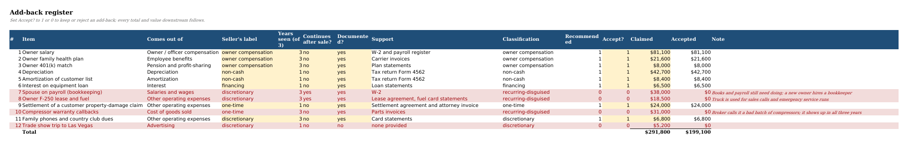
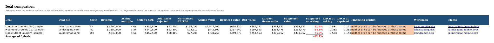

# sde-value

sde-value takes a small-business deal file (the seller's P&L and the broker's list of add-backs) and builds an Excel workbook where every add-back gets its own row with a 1/0 toggle, and the owner's job is priced at what it would cost to hire a manager. I wrote it because a broker's recast usually adds back the owner's whole salary plus anything that can be called "one-time", applies a multiple, and never puts back the cost of someone to run the place. In the HVAC sample, $31,000 of "one-time" warranty callbacks shows up in all three years, and at 4.0x the buyer pays four times that for it.

It's for people buying their first small business (or searching for one), owners who want to see how their recast will be read, and anyone doing a first pass on a listing. Each deal also gets a two-page Word memo for whoever has to make the call, and `batch` runs a whole folder of deals into one comparison sheet.

## Running it

You need Python 3.10+, and LibreOffice for `check` and the recalculation tests.

```bash
sudo apt-get install -y libreoffice-calc
pip install -e ".[test]"

python3 -m sde_value build --deal deals/hvac_service.yaml --out out/hvac_service.xlsx
python3 -m sde_value check out/hvac_service.xlsx
python3 -m sde_value check out/hvac_service.xlsx --tabs DCF,Financing,Sensitivity
python3 -m sde_value memo --deal deals/hvac_service.yaml
python3 -m sde_value batch deals/ --out out/
python3 -m sde_value dashboard out/hvac_service.xlsx --pdf docs/dashboard.pdf
python3 -m pytest
```

For the HVAC sample, `build` and the first `check` print:

```
Wrote out/hvac_service.xlsx
  Lone Star Comfort Air (sample)
  Seller's SDE            $386,800   (add-backs claimed $291,800)
  Normalised SDE          $294,100   (rejected $92,700)
  Owner replacement       $138,045
  Normalised EBITDA       $156,055
  Asking value          $1,547,200   at 4.0x
  Repriced value          $624,220   (59.7% below asking)
  DCF value               $486,172   (3.1x normalised EBITDA)
  Largest financeable     $593,621   (DSCR at asking 0.48x, needs 1.25x)
  Supported value         $593,621   (capped at the largest financeable price; neither price can be financed at these terms)

OK: 269 output cells compared after LibreOffice recalculation, 0 mismatches, 0 missing
```

The workbook opens on a dashboard ([PDF](docs/dashboard.pdf)):


and the add-back register is where the arguing happens:



Everything runs offline from the extracts in `data/`. `fetch-data` downloads the BLS and IRS files again, which was more annoying than it should have been: the BLS CDN returned 403 to Python's urllib even with browser headers, so the fetcher shells out to curl when it can.

Worked example, deal file to memo: [docs/worked-example.md](docs/worked-example.md)
Commands and options: [docs/commands.md](docs/commands.md)
Deal file format: [docs/deal-file.md](docs/deal-file.md)
DCF, Financing and Sensitivity tabs: [docs/valuation-tabs.md](docs/valuation-tabs.md)
Full sample results: [docs/sample-deals.md](docs/sample-deals.md)
Data sources: [data/SOURCES.md](data/SOURCES.md)

## How it works

Each add-back records which P&L line it comes from, what the seller calls it, how many of the last three years it appeared in, whether the cost would carry on under a new owner, and whether there are documents. The classification rule had to fit in one Excel formula, so it's short. Owner pay, depreciation and interest keep their labels. A "one-time" item seen in two or more years, or anything that continues after the sale, is recurring-disguised and gets rejected. So do undocumented discretionary or one-time items. You can override any row in the deal file or just flip the toggle in Excel.

The manager's cost comes from BLS OES wages. OES doesn't publish wages by industry and state together, so I take the national wage for the role in the 4-digit NAICS industry and scale it by how the state's cross-industry wage compares to the national one. Benefits go on top from BLS ECEC. Normalised EBITDA is net income plus accepted add-backs minus that manager, shown next to IRS SOI ratios for the same industry as a sanity check.

Three more tabs come at the price from other directions: a five-year DCF, an SBA-style loan with debt service coverage, and a grid of price and coverage across multiples and how much of the rejected add-backs you give back.

The dashboard pulls it together. Its supported value is the repriced value, capped at the largest price the cash flow can borrow against at 1.25x coverage, because a buyer can't pay more than either allows. The memo says the same thing in sentences. It lists each rejected add-back with the rule that caught it ("Called one-time but it appears in 3 of the last 3 years") and the seller's own note, then gives the financing verdict. `batch` writes a workbook and memo for every deal file in a folder plus `summary.xlsx`, where the derived columns are formulas too, and a test recalculates that sheet in LibreOffice as well.

The part I'm happiest with is the checking. The workbook writes inputs as values and everything else as named formulas, and a Python engine computes the same names. `check` recalculates the file in headless LibreOffice, reads the inputs back out, runs the engine on them and compares every output. Because it reads the workbook and not the deal file, it still works after you flip toggles. The tests break formulas on purpose to make sure it notices.

## Sample deals

The three deals in `deals/` are made up, but each P&L line is revenue times the IRS SOI ratio for that industry (a test checks this).

| Deal | Seller's SDE | Normalised EBITDA | Asking | Repriced | Cut |
|---|---:|---:|---:|---:|---:|
| HVAC service, TX, 4.0x | $386,800 | $156,055 | $1,547,200 | $624,220 | 59.7% |
| Landscaping, NC, 3.5x | $240,800 | $73,612 | $842,800 | $257,640 | 69.4% |
| Laundromat, OH, 4.5x | $157,500 | $77,705 | $708,750 | $349,673 | 50.7% |

The laundromat only needs a half-time manager, so it loses the least. The financing side surprised me more. None of the three asking prices can be borrowed at the default terms, and even the repriced values fall a little short of 1.25x coverage. So for all three the supported value is set by the loan, not the multiple: $593,621, $254,479 and $319,062, on average 62.1% below asking.



## Known issues

- The repriced value applies the broker's SDE multiple to normalised EBITDA. Small-company EBITDA multiples are often different, so read the cut as how much of the price rests on the recast, not as a fair price.
- SOI ratios cover all corporations in a minor industry, which skews bigger than a typical listing. Some SOI cells are withheld and count as zero, and landscaping has to use a broader category than its NAICS code.
- Only expense add-backs are modelled. Unreported cash, working capital and capex normalisation are what I'd add next.
- The memo is written from the deal file, not the workbook, so toggles flipped in Excel show on the dashboard but not in the memo. Set `accept:` in the deal file and rerun `memo` or `batch`.
- The summary sheet copies each deal's engine values and only recomputes the price columns, so edits inside a deal's workbook don't reach it until `batch` runs again.
- The DCF tab has a fixed number of year columns once built, so changing `dcf.years` means rebuilding.

Project period: 2026-07-13 to 2026-08-15.
