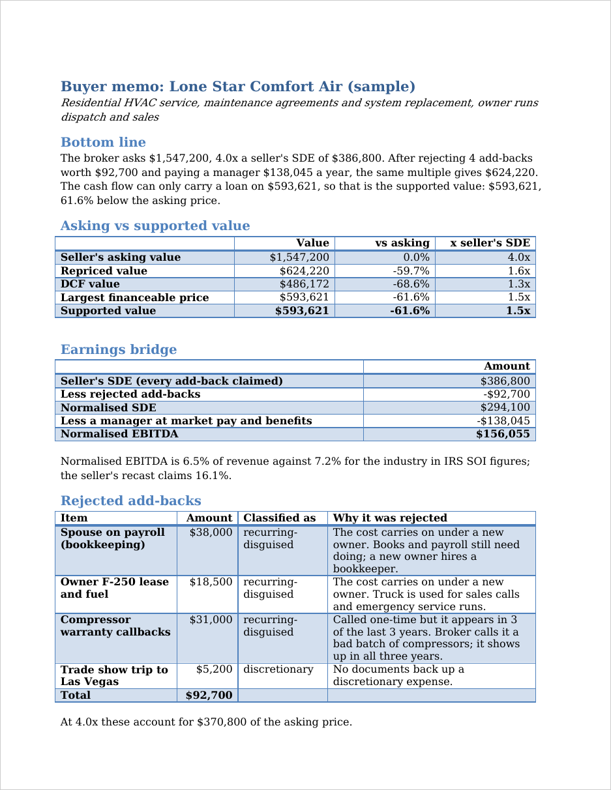

# Worked example: Lone Star Comfort Air

A walk through the HVAC sample from deal file to memo. The deal is made up, but every P&L line is $2.4M of revenue times the IRS SOI ratio for plumbing, heating and air-conditioning contractors.

## 1. The broker's pitch

The deal file ([deals/hvac_service.yaml](../deals/hvac_service.yaml)) has the P&L and twelve add-backs, the way a broker's recast lists them. They add up to $291,800, which turns $95,000 of pre-tax net income into $386,800 of seller's discretionary earnings (SDE). At the broker's 4.0x that's an asking value of $1,547,200.

## 2. Build and check the workbook

```bash
python3 -m sde_value build --deal deals/hvac_service.yaml --out out/hvac_service.xlsx
python3 -m sde_value check out/hvac_service.xlsx
```

The workbook opens on the Dashboard tab. `check` recalculates the file in headless LibreOffice and compares all 269 named output cells with the Python engine; for the dashboard alone:

```
$ python3 -m sde_value check out/hvac_service.xlsx --tabs Dashboard
OK: 5 output cells on Dashboard compared after LibreOffice recalculation, 0 mismatches, 0 missing
```

## 3. Which add-backs hold up

Owner pay, depreciation, amortisation and interest are standard add-backs and stay. A settlement with the attorney's invoice behind it is a real one-time cost and stays, and so do the family phones and club dues, which are discretionary but documented. Four items don't:

| Item | Amount | Why it's rejected |
|---|---:|---|
| Spouse on payroll (bookkeeping) | $38,000 | The books still need doing; a new owner hires a bookkeeper |
| Owner F-250 lease and fuel | $18,500 | The truck is used for sales calls and emergency runs |
| Compressor warranty callbacks | $31,000 | Called one-time, but it's in all three years |
| Trade show trip to Las Vegas | $5,200 | No documents |

That's $92,700 rejected, or $370,800 of the asking price at 4.0x.

## 4. Pay someone to do the owner's job

The owner runs dispatch and sales. A general and operations manager in building equipment contracting earns $104,960 nationally at the median; Texas pays about 2.6% less than the US across industries, so the wage comes to $102,248. The ECEC benefits load for small establishments adds 35% on top. That's $138,045 a year, which takes normalised SDE of $294,100 down to normalised EBITDA of $156,055.

## 5. What the price can be


The same 4.0x on normalised EBITDA gives a repriced value of $624,220. The DCF comes in lower, at $486,172. At 10% down, an SBA-style bank loan at 10.5% over ten years and a 10% seller note, the buyer's cash flow ($113,335 after maintenance capex) covers debt service 0.48x at the asking price and 1.19x at the repriced value. Lenders want 1.25x, which caps the price at $593,621.

The supported value is the lower of the repriced value and that cap: $593,621, 61.6% under asking. The PDF version of the dashboard is [dashboard.pdf](dashboard.pdf), made with:

```bash
python3 -m sde_value dashboard out/hvac_service.xlsx --pdf docs/dashboard.pdf
```

## 6. The memo

```bash
python3 -m sde_value memo --deal deals/hvac_service.yaml
```

writes `out/hvac_service-memo.docx`, two pages. The first:



The bottom line it opens with:

> The broker asks $1,547,200, 4.0x a seller's SDE of $386,800. After rejecting 4 add-backs worth $92,700 and paying a manager $138,045 a year, the same multiple gives $624,220. The cash flow can only carry a loan on $593,621, so that is the supported value: $593,621, 61.6% below the asking price.

The memo follows the deal file's toggles. If you flip toggles in Excel instead, the dashboard updates but the memo doesn't; set `accept:` in the deal file and rerun `memo` to get both.

## 7. All three deals at once

```
$ python3 -m sde_value batch deals/ --out out/
Deal                                     Asking     Repriced    Supported  vs ask  Financing
Lone Star Comfort Air (sample)       $1,547,200     $624,220     $593,621  -61.6%  neither price can be financed at these terms
Piedmont Grounds Co. (sample)          $842,800     $257,640     $254,479  -69.8%  neither price can be financed at these terms
Maple Street Laundry (sample)          $708,750     $349,673     $319,062  -55.0%  neither price can be financed at these terms
Wrote 3 workbooks, 3 memos and out/summary.xlsx
```

`out/summary.xlsx` puts the deals side by side, with links to each workbook and memo:


